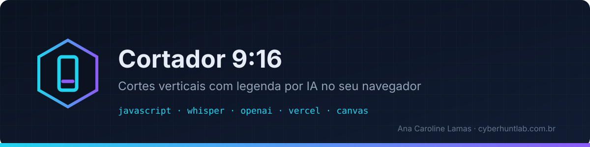
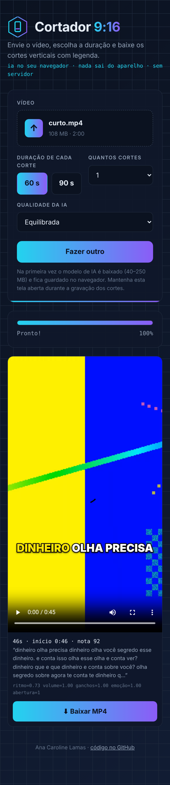

<p align="center"></p>

# Cortador 9:16 — cortes verticais com legenda por IA local

Ferramenta em **Python** que transforma um vídeo longo do YouTube em **cortes verticais 9:16 de 60 ou 90 segundos**, com **legenda gravada no vídeo**. A transcrição roda na própria máquina com **Whisper** (faster-whisper) e o corte é feito pelo **ffmpeg**: sem API de terceiros, sem chave, sem custo por minuto.

A interface pode rodar localmente ou ficar hospedada na **Vercel**, apontando para o servidor de processamento no seu PC ou numa VPS.

> Use em vídeos próprios ou de criadores que autorizaram os cortes. Publicar cortes de terceiros sem permissão viola direitos autorais e pode gerar *strike* no canal.

<p align="center"></p>

## Recursos

| Etapa | O que faz | Como |
|---|---|---|
| Download | Baixa o vídeo em até 1080p | `yt-dlp` |
| Transcrição | Texto com tempo de cada palavra | `faster-whisper` local, com cache |
| Escolha dos trechos | Pontua candidatos que começam e terminam em fim de frase | ritmo da fala, volume, palavras de gancho, perguntas e abertura |
| Corte | Recorte central 9:16 em 1080×1920 | `ffmpeg` + `libx264` |
| Legenda | Blocos curtos em caixa alta com a palavra falada destacada | `.ass` gravado no vídeo |

- **Explicável:** cada corte vem com a nota e os critérios que o fizeram ser escolhido.
- **Duração:** opção 60 s gera cortes de 45–60 s; opção 90 s, de 75–90 s.
- **Download direto** de cada corte em MP4, com prévia no navegador.
- **Token opcional** para expor o servidor numa VPS sem deixá-lo aberto.

## Arquitetura

```
index.html      interface estática  ─┐  hospedada na Vercel (ou servida pelo app.py)
                                     │  fetch + CORS
servidor/       app.py + cortador.py ┘  roda no seu PC ou VPS: yt-dlp, Whisper, ffmpeg
```

A Vercel hospeda apenas a interface. O processamento não cabe numa função serverless: precisa de ffmpeg, de um modelo de ~460 MB, leva minutos por vídeo e o YouTube bloqueia downloads vindos de data centers.

## Instalação

### Servidor (PC)

Requisitos: **Python 3.10+** e **ffmpeg**.

```bash
git clone https://github.com/ticarollamas-arch/cortador-916.git
cd cortador-916/servidor
./iniciar.sh            # Windows: iniciar.bat
```

Na primeira execução cria o `venv`, instala as dependências e baixa o modelo Whisper uma única vez. Depois abre `http://localhost:8765`.

### Servidor (VPS com Docker)

```bash
docker build -t cortador -f servidor/Dockerfile .
docker run -d -p 8765:8765 -e CORTADOR_TOKEN=um-token-longo \
  -e CORTADOR_ORIGENS=https://seu-projeto.vercel.app \
  -v cortador-modelos:/root/.cache cortador
```

Coloque um proxy com HTTPS na frente (Caddy ou Nginx): uma página da Vercel (HTTPS) não pode chamar um servidor `http://` público.

### Interface na Vercel

1. Importe este repositório em **vercel.com/new**.
2. Deixe **Framework Preset** em *Other* e os campos de build vazios: a página estática fica na raiz e é publicada sem build.
3. Abra o site, expanda **Servidor de processamento** e informe o endereço (`http://localhost:8765` ou `https://sua-vps`) e o token, se houver.

## Como usar

Na interface: cole o link → escolha **60 s** ou **90 s** e quantos cortes → **Começar** → **⬇ Baixar MP4**.

Pela linha de comando:

```bash
cd servidor
python cortador.py "https://youtube.com/watch?v=XXXX" --auto 3 --max 60
python cortador.py "https://youtube.com/watch?v=XXXX" --inicio 1:20 --fim 2:05
python cortador.py video.mp4 --inicio 0:30 --fim 1:10 --sem-legenda
```

### Variáveis do servidor

| Variável | Padrão | Uso |
|---|---|---|
| `CORTADOR_MODELO` | `small` | `tiny`, `base`, `small`, `medium`, `large-v3` |
| `CORTADOR_IDIOMA` | `pt` | idioma da fala |
| `CORTADOR_TOKEN` | vazio | exige token em todas as rotas da API |
| `CORTADOR_ORIGENS` | `*` | origens permitidas no CORS (ex.: domínio da Vercel) |
| `CORTADOR_HOST` / `CORTADOR_PORTA` | `127.0.0.1` / `8765` | endereço de escuta |

## Limitações

- Em CPU, o modelo `small` leva perto do tempo do vídeo para transcrever (1 h de vídeo ≈ 1 h). A transcrição fica em cache, então novos cortes do mesmo vídeo saem rápido. Com GPU NVIDIA é bem mais rápido.
- O recorte 9:16 é central: não segue o rosto de quem fala.
- A escolha dos trechos é heurística (texto e volume), não entende contexto. Revise antes de publicar.
- Mudanças no YouTube podem quebrar o download até o `yt-dlp` ser atualizado (`pip install -U yt-dlp`).

## Tecnologias

Python 3 · faster-whisper · yt-dlp · ffmpeg · HTML/CSS/JS sem framework · Vercel · Docker

## Licença

Distribuído sob a licença MIT. Veja [LICENSE](LICENSE).
